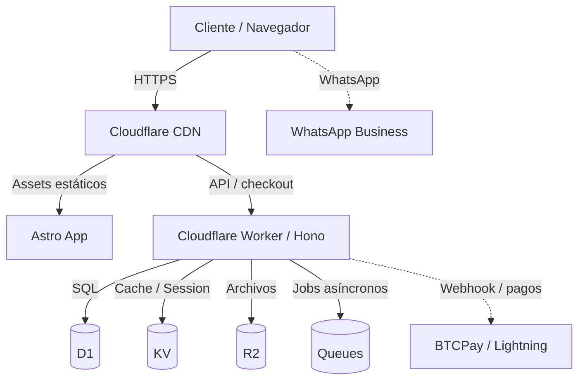

# 🥩 Temozonia

[](https://astro.build/)
[](https://workers.cloudflare.com/)
[](https://www.typescriptlang.org/)
[](https://tailwindcss.com/)
[](https://hono.dev/)
[](https://zustand-demo.pmnd.rs/)

Temozonia es una plataforma de comercio electrónico edge-first enfocada en ventas de carne ahumada artesanal, pensada para ofrecer una experiencia de compra rápida, premium y altamente conversiva. La solución combina Astro, Cloudflare Workers, Hono, D1, KV y una lógica de checkout optimizada para WhatsApp, pagos directos y métodos locales de forma simple y escalable.

> Temozonia no es solo un sitio web: es una arquitectura híbrida preparada para escalar desde un storefront de alto rendimiento hasta una plataforma SaaS o marketplace modular ejecutado en el edge.

---

## 🚀 Visión general

Temozonia está diseñado para resolver tres problemas a la vez:

1. Rendimiento extremo y SEO sólido con Astro y estáticos generados o renderizados bajo demanda.
2. Backend ligero y escalable en Cloudflare Workers utilizando Hono y servicios serverless nativos.
3. Checkout conversacional y sin fricción: pedidos por WhatsApp, transferencias, BTCPay, Lightning y flujo de compra simplificado en una sola página.

La idea central es crear una experiencia de compra que se sienta premium, local, memorable y extremadamente eficiente, sin depender de una infraestructura pesada ni de una arquitectura monolítica.

---

## ✨ Características principales

- ⚡ Rendimiento máximo con Astro + Cloudflare CDN.
- 🛒 Carrito reactivo con Zustand y persistencia local.
- 💸 Venta con múltiples métodos de pago: transferencia, tarjeta vía BTCPay, Lightning y efectivo.
- 📱 Diseño mobile-first con flujo optimizado para conversión.
- 🎨 Sistema visual premium con estética de madera, humo, oro y papel vintage.
- 🔧 Arquitectura modular preparada para expandirse a catálogo, órdenes, CRM, pagos, inventario y más.
- 🌍 Infraestructura edge-first con Cloudflare Workers y bindings listos para D1, KV, R2 y Queues.

---

## 🏗️ Stack tecnológico

| Capa | Tecnología | Propósito |
| :--- | :--- | :--- |
| Frontend | [Astro](https://astro.build/) + [React](https://react.dev/) | Rendering estático, SEO y islands interactivas |
| Estilos | [Tailwind CSS](https://tailwindcss.com/) | Diseño tokenizado y sistema visual reutilizable |
| Backend | [Hono](https://hono.dev/) | API ligera y compatible con Web Standards |
| Estado global | [Zustand](https://zustand-demo.pmnd.rs/) | Carrito y estado del cliente sin boilerplate |
| Base de datos | [D1](https://developers.cloudflare.com/d1/) | SQLite serverless para catálogo y órdenes |
| Cache/sesiones | [KV](https://developers.cloudflare.com/kv/) | Persistencia, sesiones y caché |
| Storage | [R2](https://developers.cloudflare.com/r2/) | Archivos e imágenes |
| Pagos | BTCPay / Lightning / Transferencias | Cobranza flexible y soberana |
| Tooling | TypeScript, Wrangler, ESLint, Prettier | Desarrollo robusto y maintainable |

---

## 🧠 Arquitectura



---

## 📁 Estructura del proyecto

```text
temozonia/
├── astro/                     # Frontend Astro + Tailwind
│   ├── src/
│   │   ├── components/        # Componentes reutilizables
│   │   ├── checkout/          # Lógica del carrito y checkout
│   │   ├── pages/             # Páginas del sitio
│   │   ├── stores/            # Zustand stores
│   │   ├── utils/             # Helpers, constantes y utilidades
│   │   └── styles/            # Estilos globales
│   └── astro.config.mjs
├── worker/                    # Backend edge con Hono
│   ├── index.ts               # Entry point del worker
│   └── routes/                # Endpoints API
├── scripts/                   # Utilidades, seeds y schema
├── config/                    # Config centralizada
├── public/                    # Assets públicos
├── wrangler.toml              # Configuración Cloudflare
├── package.json
├── tsconfig.json
├── README.md
└── LICENSE
```

---

## 🚦 Inicio rápido

### Requisitos

- Node.js `>= 20`
- `pnpm` o `npm`
- Cuenta de Cloudflare y Wrangler autenticado

### Instalación

```bash
git clone https://github.com/arksystems/temozonia.git
cd temozonia
pnpm install
cp .env.example .env.local
```

### Desarrollo local

```bash
pnpm dev
```

Esto levanta:

- Frontend: `http://localhost:4321`
- Worker API: `http://localhost:8787`

### Base de datos local

```bash
pnpm db:push
pnpm db:seed
```

### Build y deploy

```bash
pnpm build
pnpm deploy
```

---

## 🎨 Design system

El proyecto sigue una identidad visual orientada a la tradición y la premiumidad:

- Colores clave: `brand-500`, `gold-DEFAULT`, `dark-wood`
- Tipografía principal: `Playfair Display` para títulos
- Tipografía body: `Inter` o equivalente para lectura cómoda
- Efectos visuales: glassmorphism suave, textura de papel, elevación sutil y botones con presencia premium

Esto crea una experiencia más cercana a una marca artesanal con refinamiento moderno.

---

## 🛠️ Flujo de negocio

El modelo de negocio actual está pensado para una compra directa, rápida y altamente efectiva:

- El cliente explora productos.
- Agrega artículos al carrito.
- Revisa total, envíos y métodos de pago.
- Genera pedido por WhatsApp o por link de pago directo.
- Finaliza sin cargar procesos complejos de registro o pasarela pesada.

Esto reduce fricción, acelera conversiones y mantiene una narrativa más cercana a la venta directa artesanal.

---

## 🤝 Contribución

1. Crea una rama nueva: `git checkout -b feature/nombre-de-la-funcionalidad`
2. Haz tus cambios y asegúrate de mantener el estilo del proyecto
3. Realiza commit: `git commit -m "feat: agrega nueva funcionalidad"`
4. Sube la rama: `git push origin feature/nombre-de-la-funcionalidad`
5. Abre un Pull Request

---

## 📜 Licencia

Este proyecto se distribuye bajo la licencia MIT.

---

## 💡 Créditos

Desarrollado con ❤️ para una experiencia de venta premium, artesanal y moderna.

> “Yucatán es nuestro hogar, y el fuego es nuestro lenguaje.” 🔥
